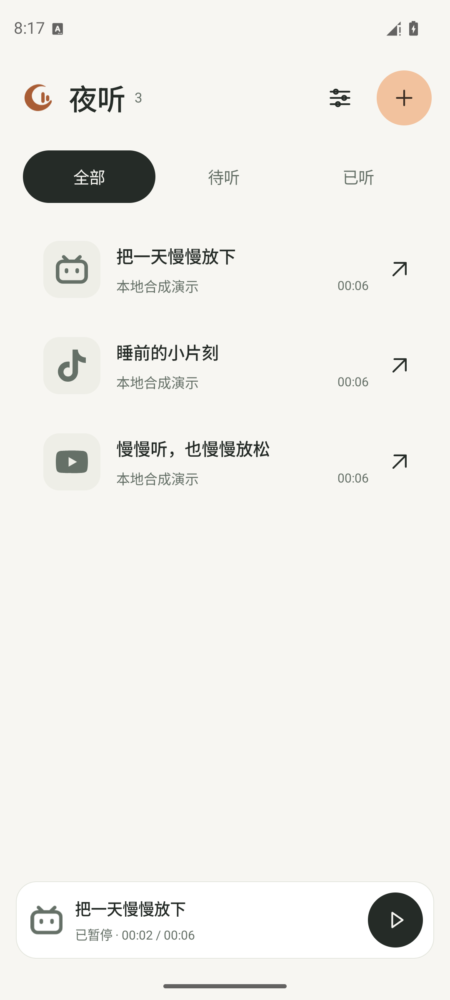
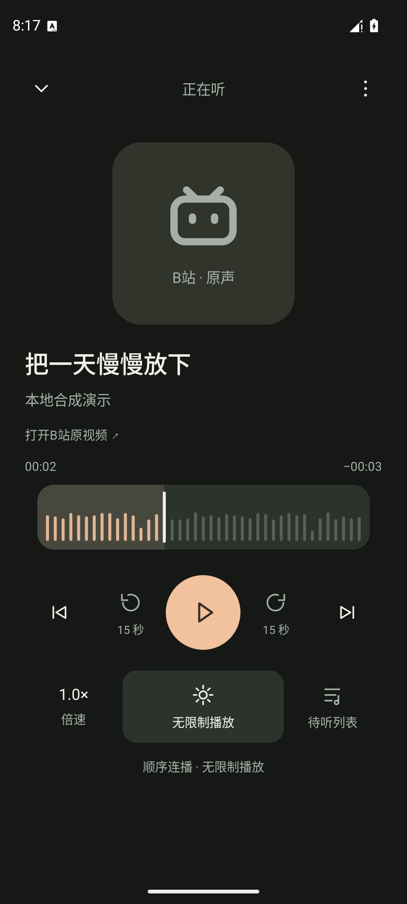

# 夜听

把想听的内容留在手机里，按自己的节奏慢慢听。

夜听是一个原生 Android 纯音频收藏播放器：收藏来源链接，在手机本地准备音频，再离线、锁屏或后台播放。需要查看原视频时，可跳转原平台。

**当前开源版本：0.2.9 / code11。采用 GPL-3.0-only。**

> 本次为源码首发，暂不提供官方 APK 下载。应用依赖的 youtubedl-android 0.18.1 含预编译原生组件，对应源码与构建资料仍有待核实的上游缺口。可自行构建用于研究；具体状态见[二进制发布记录](docs/BINARY_RELEASE.md)。

## 可以做什么

- 收藏抖音、B站、YouTube 的普通单条内容链接，在手机上获取信息和准备音频。
- 播放已准备的本地音频，记录进度，前后跳转 15 秒，调整倍速。
- 管理待听队列，顺序连播、单条循环或随机播放。
- 按分钟或条数设置睡眠停止；异常退出后恢复仍有效的限制，并保持暂停。
- 设置仅当前条目的临时倍速，切换条目时恢复全局速度。
- 浅色、深色与跟随系统外观，刻度与滚轮操作反馈，本地播放诊断。

来源平台会变化。已有实现不代表所有链接、地区、账号和网络都能成功；YouTube 已知线路问题仍未解决，详见[已知问题](docs/KNOWN_ISSUES.md)。请只处理你有权保存和使用的内容。

## 界面

截图来自隔离模拟器，使用合成条目和合成音频，不代表平台内容获取成功。

<p>
  
  
</p>

## 自行构建

需要 JDK 21、Android SDK 36、Build Tools 35.0.0，以及访问 Google Maven、Maven Central 和 Gradle 分发的网络。最低 Android 8 / API26；当前仅构建 arm64-v8a。

```sh
git clone https://github.com/he-qianhang/yeting.git
cd yeting/android
export ANDROID_HOME=/path/to/Android/sdk
./gradlew :app:assembleDebug
```

Windows 使用 `gradlew.bat`。设置 `JAVA_HOME` 指向自己的 JDK；Android Studio 也可打开 `android/`。无需维护者的私人密钥，debug 使用本机调试签名；release 默认生成未签名 APK。签名、单元测试和设备测试见[构建说明](docs/BUILDING.md)。

自行签名的安装包与维护者已有签名不同，不能直接覆盖原签名版本。请使用独立测试环境，保留原设备数据。

## 数据与网络

收藏、音频、进度和设置存于应用私有目录，系统备份关闭。获取内容会访问来源平台；必要的来源会话保存在本 App 的网页组件中。应用没有自建云端准备服务或运行时模型调用。诊断由用户主动复制，不自动上传。[隐私与权限说明](docs/PRIVACY.md)。

## 项目结构

| 路径 | 内容 |
| --- | --- |
| `android/` | Kotlin 原生界面、Media3 播放、本地收藏、来源准备与测试 |
| `tools/` | 通用构建、合成测试音频、隔离设备验收、可选网页脚本构建 |
| `third_party/` | 第三方源码包、版权许可与来源清单 |
| `feasibility/` | 固定提取器与 Android 引擎构件的版本和哈希 |
| `docs/` | 构建、验证、隐私、版本来源和已知问题 |

本次公开快照基于已经交付的 0.2.9，未引入后续版本功能；原开发历史、个人资料及完整内部测试包未公开。[版本来源](docs/PROVENANCE.md)、[验证记录](docs/TESTING.md)、[更新记录](CHANGELOG.md)。

## 参与与许可

欢迎报告可复现问题、修正文档和提交小范围改动，见[贡献说明](CONTRIBUTING.md)。漏洞请使用[私密报告入口](https://github.com/he-qianhang/yeting/security/advisories/new)，见[安全政策](SECURITY.md)。这是个人维护项目，不承诺固定响应时间。

原创代码 Copyright (C) 2026 he-qianhang，以 [GNU GPL v3.0 only](LICENSE) 发布；第三方文件保留各自许可和版权。[第三方声明](THIRD_PARTY_NOTICES.md)。GPLv3 允许商业使用；平台名称和商标归各权利人，不表示官方合作。
